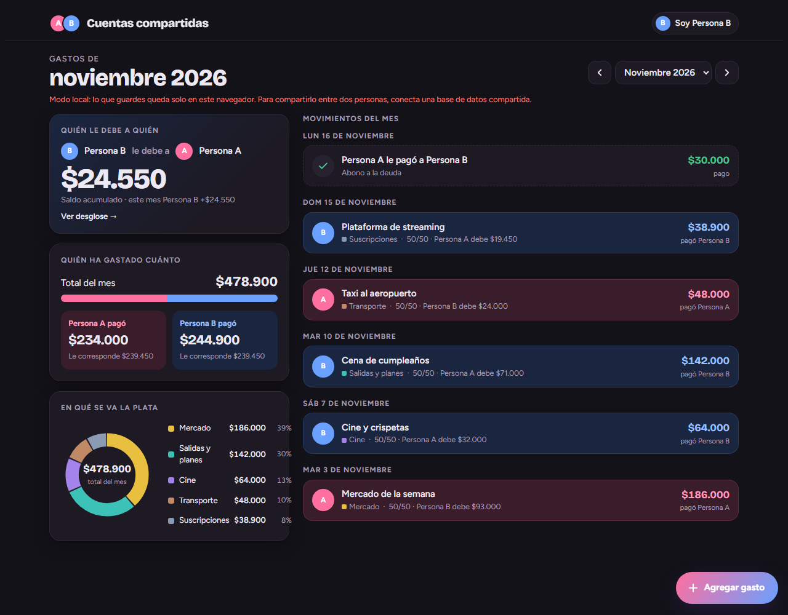

# Shared Expenses

A single-file web app for two people who share costs (a couple, roommates, travel partners). Log who paid what, choose how each expense is split, and always see who owes whom.

*Screenshot with made-up sample data.*

## What problem it solves

Splitting costs in a chat or a notes app gets messy fast. This page keeps a running balance: every expense and every repayment updates the debt automatically, month by month.

## Features

- **Running balance** ("who owes whom") with a full breakdown.
- **Who has spent how much** this month, and what each person's fair share is.
- **Flexible splits**: 50/50, "the other person owes all of it", or "only mine".
- **Repayments** that reduce the debt.
- **Spending by category** with a donut chart (food, outings, cinema, subscriptions, travel, groceries, transport, gifts, other).
- **Month navigation** and a filter by category.
- Light and dark themes, works on phones and desktop.

## Run it

Open `index.html` in any modern browser. That is it.

By default data is saved in the browser (`localStorage`), so it stays on that device. The page also supports a shared document database when it runs inside an environment that provides one (it was first built as a Claude artifact), so two people can see the same data in real time.

## Tech

One HTML file with plain CSS and JavaScript · no dependencies · no build step

## License

[MIT](LICENSE)
